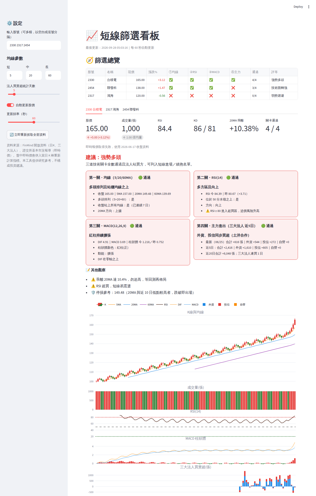

# 📈 短線篩選看板（台股）

輸入股號，自動抓取股價與三大法人籌碼，依「短線篩選檢核機制」逐關檢查，並以看板呈現所有指標與操作建議。開啟後會依設定頻率自動更新即時股價並重新計算。

（截圖為測試資料）

## 檢核機制

| 關卡 | 條件 | 通過判定 |
|---|---|---|
| ① 均線 | 短中長均線多頭排列，K 線站穩所有均線之上 | 5MA > 20MA > 60MA 且收盤價 > 三條均線（均線天數可在側邊欄調整） |
| ② RSI | RSI > 50 多空分水嶺且方向向上 | RSI(14) > 50 且今日 RSI > 昨日 |
| ③ MACD | 柱狀體為正（紅柱）且動能擴張或翻揚 | OSC > 0 且今日 OSC > 昨日（另標示「由綠翻紅」「縮後再放」） |
| ④ 主力進出 | 三大法人籌碼站在買方 | 近 N 日（預設 5）三大法人合計買超，且外資或投信買超 |

### 綜合建議

| 技術三關 | 主力 | 評等 |
|---|---|---|
| 3/3 | 通過 | 🔴 強勢多頭：可列入進場／續抱名單 |
| 3/3 | 未過／無資料 | 技術面轉強：小量試單、觀察法人 |
| 2/3 | — | 偏多觀察 |
| 1/3 | — | 中性偏弱 |
| 0/3 | — | 弱勢迴避 |

另外附上：乖離過大／RSI 超買警示、價量關係、KD 交叉，以及停損參考價（20MA 與近 10 日低點中，低於現價的較高者）。

## 下載執行檔（免安裝 Python）

1. 到 GitHub repo 的 **Actions** 頁 → 點選最新一次 **Build StockDashboard executable**。
2. 在頁面最下方 **Artifacts** 下載 `StockDashboard-windows`（或 `StockDashboard-macos`），解壓縮。
3. 雙擊 `StockDashboard.exe`，會出現一個黑色視窗，並自動在瀏覽器開啟看板（http://localhost:8501）。
4. 要結束程式時，關閉黑色視窗即可。

> 第一次執行約需 10～20 秒解壓。Windows SmartScreen 若跳出「Windows 已保護您的電腦」，點「其他資訊」→「仍要執行」。

### 自行打包

```bash
cd stock_dashboard
pip install -r requirements.txt pyinstaller
pyinstaller --noconfirm stock_dashboard.spec   # 產出 dist/StockDashboard(.exe)
```

PyInstaller 只能打包目前作業系統的版本：要 Windows 版就在 Windows 上執行，或交給 GitHub Actions 打包。

## 用 Python 執行（開發用）

```bash
cd stock_dashboard
pip install -r requirements.txt
streamlit run app.py
```

瀏覽器會自動開啟 http://localhost:8501。

- 左側輸入股號，可一次輸入多檔（例：`2330 2317 6488`），上市、上櫃皆可。
- 「自動更新股價」預設開啟，每 60 秒抓取即時報價，併入當日 K 棒後重算所有指標。
- 日 K 與法人資料會快取 30 分鐘；按「立即重新抓取全部資料」可強制更新。

## 資料來源

- **日 K 線、三大法人、股票名稱**：[FinMind](https://finmindtrade.com/) 開放資料 API。若查詢量大，可註冊取得 token 後設定環境變數 `FINMIND_TOKEN`。
- **日 K 備援**：Yahoo Finance。
- **盤中即時價**：證交所基本市況報導（mis.twse.com.tw）。

> 「主力進出」這一關以三大法人（外資、投信、自營商）買賣超代表。分點券商的主力資料需付費 API，未納入。

## 測試

```bash
python -m pytest -q tests
```

⚠️ 本工具僅供研究參考，不構成任何投資建議。
